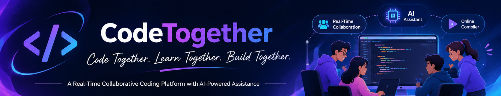

<div align="center">
  

  <h1>CodeTogether</h1>
  <p><strong>Code Together. Learn Together. Build Together.</strong></p>
  <p>A real-time collaborative coding platform with integrated communication, code execution, and AI-powered assistance.</p>
  <p>
    <a href="https://github.com/Dharani42426">GitHub Profile</a>
  </p>
</div>

---

## 🌟 About the Project

CodeTogether is a web-based collaborative coding platform that brings essential programming and communication tools into one workspace. Users can join shared rooms, edit code together in real time, communicate with other participants, run code, practice programming problems, and use an AI assistant for code explanations, debugging, optimization, and complexity analysis.

The project is designed for pair programming, student learning, remote collaboration, and technical interview practice—without constantly switching between separate tools.

## ✨ Features

- **Real-time collaborative coding:** Shared coding rooms with live code updates and cursor tracking using Socket.IO.
- **Online code execution:** Run programs through the Judge0 integration.
- **AI coding assistant:** Get help with code explanation, debugging, optimization, and complexity analysis using the Gemini integration. Fallback demo responses are available when Gemini is not configured.
- **Integrated chat:** Communicate with other room participants.
- **Video calling and whiteboard:** Collaborate through the included video-call and whiteboard components.
- **Coding practice:** Browse programming problems and submit solutions.
- **User dashboard:** View profile information, activity, history, and leaderboard information.
- **Authentication:** Register and log in with JWT-based authentication and password hashing.

## 🛠️ Tech Stack

| Area | Technologies |
|---|---|
| Frontend | React, Vite, CSS |
| Backend | Node.js, Express.js |
| Database | MongoDB, Mongoose |
| Real-time communication | Socket.IO |
| Code execution | Judge0 API |
| AI assistance | Google Gemini API |
| Authentication | JSON Web Tokens (JWT), bcryptjs |
| HTTP requests | Axios |

## 🏗️ How It Works

1. The React frontend provides the coding workspace and application interface.
2. The Express backend exposes API endpoints for authentication, users, rooms, chat, problems, submissions, and AI assistance.
3. MongoDB stores application data such as users, rooms, messages, problems, and submissions.
4. Socket.IO handles real-time room events, including code changes, cursor updates, and participant communication.
5. The backend connects to Judge0 for code execution and Google Gemini for AI-powered coding help when the relevant API credentials are configured.

## 📁 Project Structure

```text
CodeTogether/
├── banner.png
├── README.md
├── package.json
├── client/
│   ├── public/
│   └── src/
│       ├── components/
│       ├── layouts/
│       ├── pages/
│       └── services/
└── server/
    ├── config/
    ├── controllers/
    ├── middleware/
    ├── models/
    ├── routes/
    ├── sockets/
    ├── tests/
    ├── utils/
    └── server.js
```

## ⚙️ Installation and Setup

### Prerequisites

- Node.js and npm installed
- MongoDB running locally, or a MongoDB Atlas connection string
- Judge0 API credentials if you want to use the external code-execution service
- Gemini API credentials if you want live AI responses

### 1. Clone the repository

```bash
git clone https://github.com/Dharani42426/CodeTogether.git
cd CodeTogether
```

> If your GitHub repository has a different name, replace `CodeTogether` in the clone URL with the exact repository name.

### 2. Install dependencies

Run this command from the project root:

```bash
npm run install:all
```

### 3. Configure environment variables

Create a file named `.env` inside the `server` folder (`server/.env`). Use the following template and replace the placeholder values with your own configuration:

```env
PORT=5000
MONGO_URI=mongodb://127.0.0.1:27017/codetogether
JWT_SECRET=replace_with_a_long_random_secret
JWT_EXPIRE=7d

JUDGE0_API_URL=https://judge0-ce.p.rapidapi.com
JUDGE0_API_KEY=your_judge0_rapidapi_key_here
JUDGE0_API_HOST=judge0-ce.p.rapidapi.com

GEMINI_API_KEY=your_gemini_api_key_here
GEMINI_API_URL=https://generativelanguage.googleapis.com/v1beta/models/gemini-pro:generateContent

CLIENT_URL=http://localhost:5173
```

For MongoDB Atlas, use the connection string supplied by your Atlas cluster as `MONGO_URI`. Judge0 and Gemini credentials can be left as placeholders for local setup; the project contains fallback responses when these integrations are not configured. Actual code execution requires a working Judge0 API configuration.

**Security:** Never commit `server/.env` or paste real API keys into source code. The repository `.gitignore` excludes environment files. If a real key has already been pushed to a public repository, revoke or rotate it.

### 4. Start the backend

Open a terminal at the project root and run:

```bash
npm run server
```

The backend API is available at `http://localhost:5000` when it starts successfully.

### 5. Start the frontend

Open a second terminal at the project root and run:

```bash
npm run client
```

Vite normally serves the frontend at `http://localhost:5173`.

### 6. Open the application

Visit `http://localhost:5173` in your browser. Check the backend health endpoint at `http://localhost:5000/api/health` to confirm that the API is responding.

## 🧪 Verify the Installation

After starting both terminals:

1. Confirm the backend terminal reports that the server is running on port `5000` and MongoDB connects successfully.
2. Open `http://localhost:5000/api/health`. A successful response should include `"success": true` and the message `CodeTogether API is running`.
3. Open `http://localhost:5173` and confirm that the frontend loads.
4. Register a test account and sign in.
5. Create a coding room, open it in another browser window or with another test account, and check whether room updates and chat are synchronized.
6. Try the AI assistant. Without a Gemini key, the fallback demo responses should be returned; live Gemini responses require valid credentials.
7. Try code execution only after configuring a working Judge0 API key.

To check that the frontend production build compiles, open another terminal at the project root and run:

```bash
cd client
npm run build
```

## 📸 Screenshots

Add screenshots of the running application to a `screenshots/` folder and link them here as the project UI is captured. Suggested screenshots:

- Landing page
- User dashboard
- Collaborative coding room
- Integrated chat/video call/whiteboard
- AI coding assistant
- Coding practice page

## 🔮 Future Improvements

- Continue improving collaborative editing reliability and conflict handling.
- Expand supported languages and code-execution options.
- Enhance AI-assisted learning and debugging workflows.
- Add more coding challenges and progress insights.
- Improve accessibility, responsiveness, and automated test coverage.

## 👩‍💻 Developer

**Dharani**  
GitHub: [@Dharani42426](https://github.com/Dharani42426)

---

If you find this project interesting, consider giving the repository a ⭐ on GitHub!

<div align="center"><strong>Code Together. Learn Together. Build Together.</strong></div>
