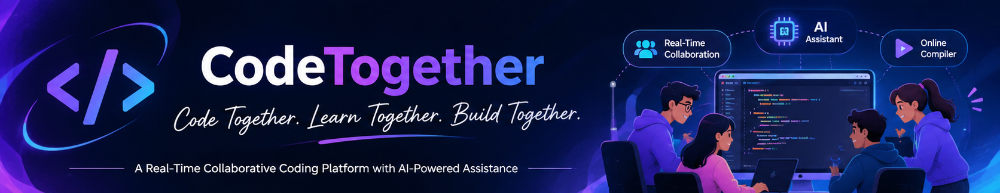

<div align="center">
  

  <h1>CodeTogether</h1>
  <p><strong>Code Together. Learn Together. Build Together.</strong></p>
  <p>A real-time collaborative coding platform with integrated communication, code execution, and AI-powered assistance.</p>
  <p>
    <a href="https://github.com/Dharani42426">GitHub Profile</a>
  </p>
</div>

---

## 🌟 About the Project

CodeTogether is a web-based collaborative coding platform that brings essential programming and communication tools into one workspace. Users can join shared rooms, edit code together in real time, communicate with other participants, run code, practice programming problems, and use an AI assistant for code explanations, debugging, optimization, and complexity analysis.

The project is designed for pair programming, student learning, remote collaboration, and technical interview practice—without constantly switching between separate tools.

## ✨ Features

- **Real-time collaborative coding:** Shared coding rooms with live code updates and cursor tracking using Socket.IO.
- **Online code execution:** Run programs through the Judge0 integration.
- **AI coding assistant:** Get help with code explanation, debugging, optimization, and complexity analysis using the Gemini integration. Fallback demo responses are available when Gemini is not configured.
- **Integrated chat:** Communicate with other room participants.
- **Video calling and whiteboard:** Collaborate through the included video-call and whiteboard components.
- **Coding practice:** Browse programming problems and submit solutions.
- **User dashboard:** View profile information, activity, history, and leaderboard information.
- **Authentication:** Register and log in with JWT-based authentication and password hashing.

## 🛠️ Tech Stack

| Area | Technologies |
|---|---|
| Frontend | React, Vite, CSS |
| Backend | Node.js, Express.js |
| Database | MongoDB, Mongoose |
| Real-time communication | Socket.IO |
| Code execution | Judge0 API |
| AI assistance | Google Gemini API |
| Authentication | JSON Web Tokens (JWT), bcryptjs |
| HTTP requests | Axios |

## 🏗️ How It Works

1. The React frontend provides the coding workspace and application interface.
2. The Express backend exposes API endpoints for authentication, users, rooms, chat, problems, submissions, and AI assistance.
3. MongoDB stores application data such as users, rooms, messages, problems, and submissions.
4. Socket.IO handles real-time room events, including code changes, cursor updates, and participant communication.
5. The backend connects to Judge0 for code execution and Google Gemini for AI-powered coding help when the relevant API credentials are configured.

## 📁 Project Structure

```text
CodeTogether/
├── banner.png
├── README.md
├── package.json
├── client/
│   ├── public/
│   └── src/
│       ├── components/
│       ├── layouts/
│       ├── pages/
│       └── services/
└── server/
    ├── config/
    ├── controllers/
    ├── middleware/
    ├── models/
    ├── routes/
    ├── sockets/
    ├── tests/
    ├── utils/
    └── server.js
```


## ⚙️ Installation and Setup

### Prerequisites

Before running CodeTogether, make sure you have the following installed:

- [Node.js](https://nodejs.org/) and npm
- MongoDB running locally, or a MongoDB Atlas connection string
- Judge0 API credentials (required for external code execution)
- Gemini API credentials (required for live AI responses)

### 1. Clone the Repository

Clone the CodeTogether repository using:

```bash
git clone https://github.com/Dharani42426/Real-time-coding-together.git
```

Navigate to the project directory:

```bash
cd Real-time-coding-together
```

### 2. Install Dependencies

Run the following command from the project root directory:

```bash
npm run install:all
```

This installs the required dependencies for both the frontend and backend.

### 3. Configure Environment Variables

Create a file named `.env` inside the `server` folder:

```text
server/.env
```

Add the following environment variables and replace the placeholder values with your actual configuration:

```env
PORT=5000

MONGO_URI=mongodb://127.0.0.1:27017/codetogether

JWT_SECRET=replace_with_a_long_random_secret
JWT_EXPIRE=7d

JUDGE0_API_URL=https://judge0-ce.p.rapidapi.com
JUDGE0_API_KEY=your_judge0_rapidapi_key_here
JUDGE0_API_HOST=judge0-ce.p.rapidapi.com

GEMINI_API_KEY=your_gemini_api_key_here
GEMINI_API_URL=https://generativelanguage.googleapis.com/v1beta/models/gemini-pro:generateContent

CLIENT_URL=http://localhost:5173
```

**Note:**

- For MongoDB Atlas, replace the `MONGO_URI` with your Atlas connection string.
- Judge0 API credentials are required for actual online code execution.
- Gemini API credentials are required for live AI-powered responses.
- The application includes fallback responses when the external AI integration is not configured.

**Security:** Never upload your actual `.env` file or expose API keys in your source code. The `.gitignore` file excludes environment files from Git tracking.

If any API key has already been exposed publicly, revoke it and generate a new one.

### 4. Start the Backend Server

Open a terminal in the project root directory and execute:

```bash
npm run server
```

The backend server will run at:

```text
http://localhost:5000
```

### 5. Start the Frontend

Open another terminal in the project root directory and execute:

```bash
npm run client
```

The frontend application will run at:

```text
http://localhost:5173
```

### 6. Open the Application

Open your browser and visit:

```text
http://localhost:5173
```

You can now access the CodeTogether application.

---

## 🧪 Verify the Installation

After starting both the frontend and backend, perform the following checks:

1. Verify that the backend server starts successfully and connects to MongoDB.
2. Open `http://localhost:5000/api/health` to check whether the backend API is responding.
3. Open `http://localhost:5173` and confirm that the frontend application loads successfully.
4. Register a test account and log in.
5. Create a coding room and join it using another browser window or test account.
6. Verify whether code changes, cursor positions, and chat messages are synchronized between participants.
7. Test the AI assistant. Live AI responses require valid Gemini API credentials.
8. Test code execution using a working Judge0 API configuration.

### Build the Frontend

To verify that the frontend production build completes successfully, open another terminal and execute:

```bash
cd client
npm run build
```

If the build completes successfully, the frontend has compiled without build errors.

---

## 📸 Screenshots

Screenshots of the actual application will be added here to demonstrate its interface and functionality.

Create a `screenshots` folder in the project root and add the following screenshots:

### 🏠 Landing Page


### 📊 User Dashboard


### 💻 Collaborative Coding Room


### 🤖 AI Coding Assistant


### 🧩 Coding Practice


If you find this project interesting, consider giving the repository a ⭐ on GitHub!

<div align="center"><strong>Code Together. Learn Together. Build Together.</strong></div>
